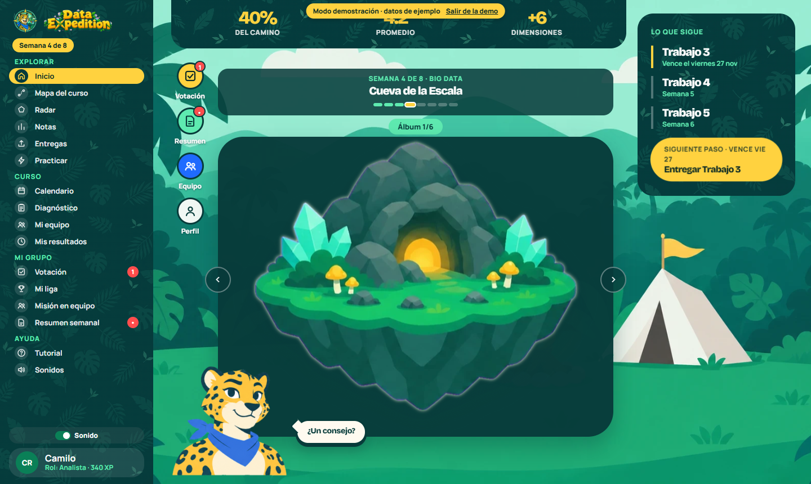
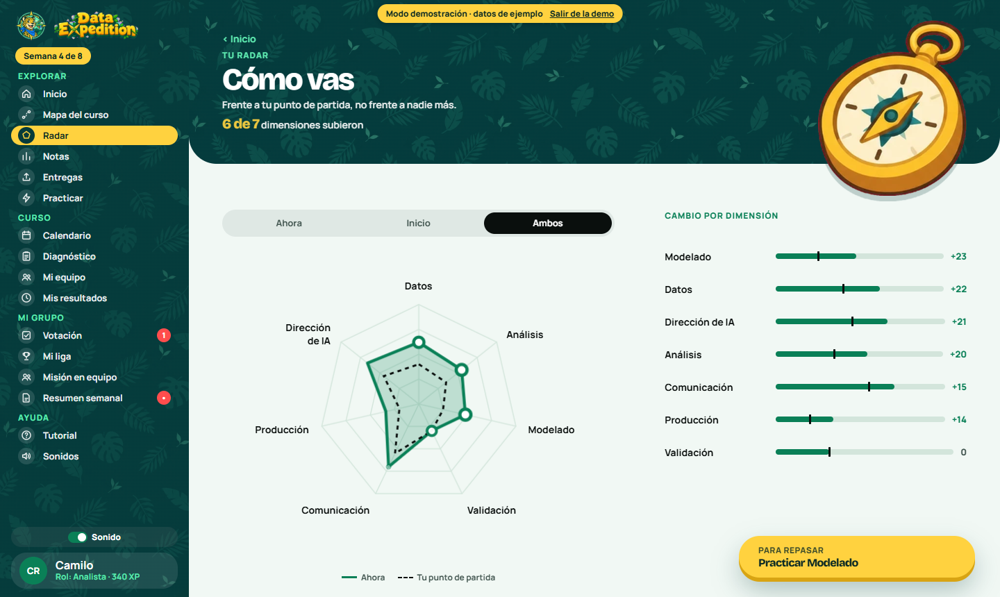
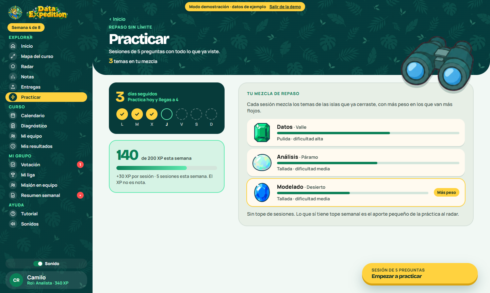
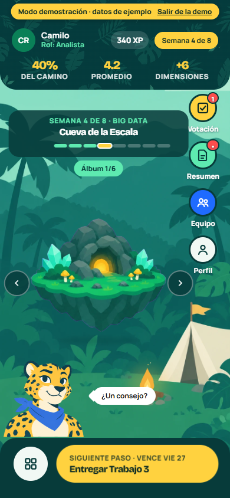
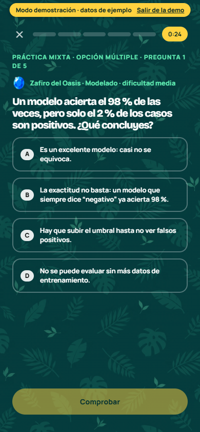
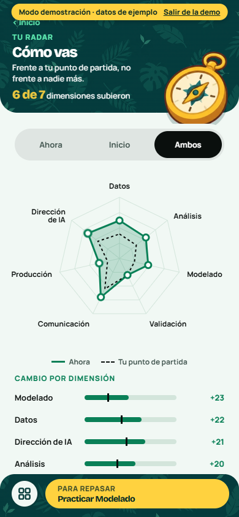
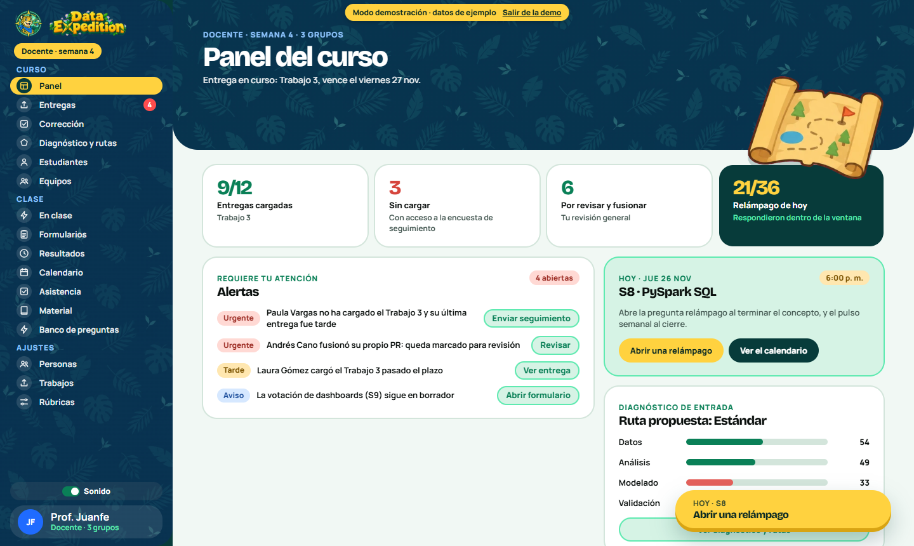
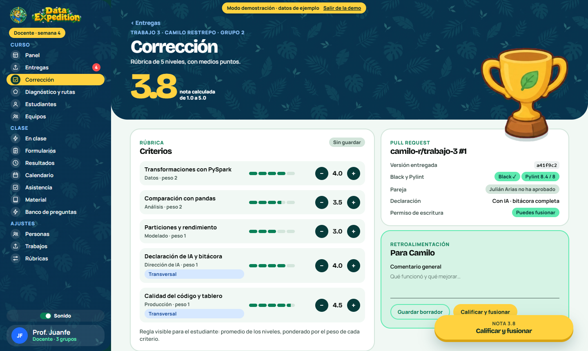
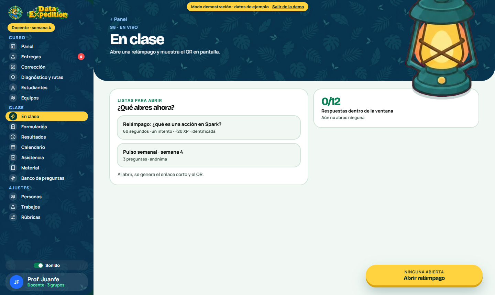

# data-expedicion

<p align="center">
  
  
  
  
  
</p>

App de seguimiento, calificación y gamificación para un curso de ciencia de datos. Cada estudiante tiene un radar de habilidades que parte de un diagnóstico y se compara siempre contra su propio punto de partida, junto con notas por rúbrica, declaración de uso de IA y lecciones cortas pensadas para el celular. Todo va envuelto en una expedición con un jaguar como guía.

🔗 **Demo del prototipo:** https://juanfeds.com/data-expedition/

---

## 📑 Tabla de contenido

1. [Contexto y motivación](#-1-contexto-y-motivación)
2. [Funcionalidades](#-2-funcionalidades)
3. [Pantallas](#-3-pantallas)
4. [Estado del proyecto](#-4-estado-del-proyecto)
5. [Arquitectura](#-5-arquitectura)
6. [Modelo de datos](#-6-modelo-de-datos)
7. [Guía de uso](#-7-guía-de-uso)
8. [Contacto](#-8-contacto)

---

## 🎯 1. Contexto y motivación

El curso se repensó para la era de la IA: la evaluación se rediseña antes que la clase, se permite la IA con declaración obligatoria y cada estudiante construye un perfil de habilidades que evoluciona con el trabajo. Ninguna herramienta conocida une rúbricas por niveles que alimentan un radar, nota tradicional aparte, declaración de IA por entrega, lecciones tipo Duolingo y votaciones por grupo. Un LMS califica pero no calcula el radar ni gamifica; una hoja de cálculo no ofrece lecciones en el celular ni vistas privadas. De ahí esta app. El diseño completo está en [`docs/RFC-010-app-expedicion.md`](docs/producto/RFC-010-app-expedicion.md).

---

## ✨ 2. Funcionalidades

| | Funcionalidad |
|---|---|
| 📊 | **Radar por estudiante**, calculado con la evidencia de cada dimensión y comparado con su punto de partida |
| 🧪 | **Diagnóstico** de la semana 1 que fija ese punto de partida (no cuenta para aprobar) |
| 📝 | **Rúbricas de 5 niveles** que dan la nota de 1.0 a 5.0, con decimales, y una regla visible para el estudiante |
| 🤖 | **Declaración de IA por entrega** ("con IA" o "sin IA"), con bitácora cuando se usó |
| ⚡ | **Lecciones** de 3 a 5 minutos para el celular, con XP y un aporte pequeño y con tope al radar |
| 💎 | **Gemas y álbum por isla**: cada isla cerrada da una gema y abre su álbum de fotos con preguntas de repaso; el nivel de pulido sube la dificultad |
| 🔥 | **Practicar**: sesiones de repaso sin límite con todo lo visto, para sostener racha por días y XP |
| 🤝 | **Misiones en equipo** y **votaciones** por grupo (modo colaborativo o competitivo) |
| 🗳️ | **Votación en vivo** durante la clase |
| 📬 | **Resumen semanal** dentro de la app y por correo |
| 🐆 | **Jaguar guía**, con frases por isla y consejos |

**Fuera de alcance:** integración con el LMS, tabla de posiciones global, detectores de IA y chat o foro.

---

## 📸 3. Pantallas

Capturas del modo demo (`?demo`, datos ficticios). La misma app tiene un centro para cada rol: el estudiante entra por el campamento y el docente por el panel del curso.

### Estudiante

<p align="center">
  
</p>
<p align="center"><sub><b>Campamento.</b> La isla de la semana, el siguiente paso y el jaguar con sus consejos.</sub></p>

<p align="center">
  
</p>
<p align="center"><sub><b>Radar.</b> Cada dimensión se compara con el punto de partida del propio estudiante, no con el resto.</sub></p>

<p align="center">
  
</p>
<p align="center"><sub><b>Practicar.</b> Racha por días, XP de la semana y una mezcla de repaso que pesa más lo que va más flojo.</sub></p>

<table align="center">
  <tr>
    <td align="center"><br /><sub>Campamento</sub></td>
    <td align="center"><br /><sub>Lección</sub></td>
    <td align="center"><br /><sub>Radar</sub></td>
  </tr>
</table>

### Docente

<p align="center">
  
</p>
<p align="center"><sub><b>Panel del curso.</b> Entregas cargadas, alertas que piden atención, la clase de hoy y el diagnóstico de entrada.</sub></p>

<p align="center">
  
</p>
<p align="center"><sub><b>Corrección.</b> Rúbrica de 5 niveles con medios puntos, datos del pull request, declaración de IA y retroalimentación.</sub></p>

<p align="center">
  
</p>
<p align="center"><sub><b>En clase.</b> Abre una relámpago o un pulso y muestra el enlace y el QR en pantalla.</sub></p>

---

## 🗺️ 4. Estado del proyecto

- ✅ **App conectada a Supabase** (`web/`): acceso con Google o enlace por correo, roles (estudiante, docente, observador), cursos con invitaciones, trabajos y entregas por PR, rúbricas y calificación, formularios (relámpagos, votaciones y encuestas), calendario y material, equipos por trabajo, diagnóstico y radar, práctica con XP y racha, liga semanal, asistencia con QR rotativo y vistas agregadas para observadores.
- ✅ **Modo demo** (`?demo`): las mismas pantallas con datos ficticios, como referencia de diseño.
- ✅ **Seguridad en la base:** RLS en todas las tablas y funciones de servidor para lo sensible; hay pruebas SQL en [`supabase/pruebas/`](supabase/pruebas/funciones_y_politicas.sql).
- ✅ **Pruebas:** 221 pruebas unitarias (dominio, servicios, componentes y pantallas clave) con mínimos de cobertura exigidos en CI.
- ⚠️ **Sin validar con sesiones reales:** las pantallas se probaron con datos simulados y en modo demo; falta el recorrido por rol contra Supabase real, descrito en [`docs/verificacion-real.md`](docs/verificacion-real.md).
- ⏳ **Pendiente:** álbum de gemas, misión en equipo, verificación del PR contra la API de GitHub, correo propio para los enlaces de ingreso, pruebas de punta a punta con navegador, las pruebas SQL en CI y el análisis general de los datos recopilados.

El producto y sus decisiones están en [`docs/producto/`](docs/producto/RFC-010-app-expedicion.md); el mapa de pantallas, en [`docs/producto/plan-de-accion-pantallas.md`](docs/producto/plan-de-accion-pantallas.md).

---

## 🏛️ 5. Arquitectura

La guía completa está en [`docs/arquitectura.md`](docs/arquitectura.md). En resumen:

```
data-expedicion/
├── web/                    # la app (React 19 + Vite + TypeScript)
│   └── src/
│       ├── app/            # arranque, rutas y registro de pantallas
│       ├── compartido/     # ui/, estado/ (sesión, curso, desbloqueos), navegacion/
│       ├── dominio/        # reglas puras y sus pruebas: niveles, nota, radar, reglas
│       ├── servicios/      # acceso a Supabase y lógica de datos
│       ├── funciones/      # una carpeta por tema, con pantallas docente/, estudiante/ y comun/
│       ├── demo/           # datos y pantallas de ejemplo (solo modo demo)
│       └── estilos/        # tokens, pantallas y capa de escritorio
├── supabase/               # migraciones numeradas y pruebas SQL
├── docs/                   # producto/, curso/, diseno/, historial/ y arquitectura.md
└── .github/workflows/      # despliegue a Pages y revisión de ramas
```

**Reglas clave:** las pantallas no hablan con Supabase (usan `servicios/`); el dominio no importa nada de fuera de sí mismo y puede correr también en una función de servidor; la seguridad vive en la base de datos.

---

## 🗄️ 6. Modelo de datos

Las migraciones en [`supabase/migrations/`](supabase/migrations/) se aplican en orden (0001 en adelante). Cada estudiante lee solo lo suyo, el docente lee su curso y el observador solo recibe agregados con mínimo de 5 personas.

| Área | Tablas |
|---|---|
| Cursos y personas | `ediciones`, `perfiles`, `matriculas`, `invitaciones`, `correos_autorizados` |
| Trabajos y calificación | `trabajos`, `criterios`, `entregas`, `entregas_versiones`, `calificaciones`, `dimensiones` |
| Radar y diagnóstico | `evidencias_radar`, `diagnosticos` |
| Clase | `sesiones`, `recursos`, `formularios`, `preguntas_formulario`, `respuestas_formulario`, `asistencias`, `equipos_trabajo` |
| Práctica | `banco_preguntas`, `practica_sesiones`, `practica_respuestas` |
| Registro | `eventos`, `progreso_usuario` |

---

## ⚙️ 7. Guía de uso

### Requisitos
- Node.js 22 o superior

### Ejecutar la app
```bash
git clone https://github.com/JuanFeDS/data-expedition.git
cd data-expedition/web
npm install
npm run dev
```
Se abre en `http://localhost:5173`. Sin variables de Supabase (`VITE_SUPABASE_URL` y `VITE_SUPABASE_PUBLISHABLE_KEY` en `web/.env.local`) arranca en modo demo; con `?demo` lo fuerza. En modo demo, `#/todas` muestra la galería de todas las pantallas.

### Comprobaciones
| Comando (en `web/`) | Qué hace |
|---|---|
| `npm run check` | Tipos, lint y pruebas, todo junto |
| `npm run typecheck` | Revisa tipos |
| `npm run lint` | Busca errores probables (oxlint) |
| `npm test` | Pruebas unitarias de dominio, servicios, componentes y pantallas (Vitest) |
| `npm run test:cobertura` | Pruebas con cobertura y mínimos exigidos |
| `npm run build` | `check` y construye la app |

### Despliegue
Cada push a `main` construye `web/` y lo publica en GitHub Pages con [`.github/workflows/pages.yml`](.github/workflows/pages.yml). `VITE_BASE` define la ruta base (`/data-expedition/`). Las ramas y pull requests corren [`revision.yml`](.github/workflows/revision.yml).

---

## 📬 8. Contacto

JuanFe — [jmartinezbernal02@gmail.com](mailto:jmartinezbernal02@gmail.com)
